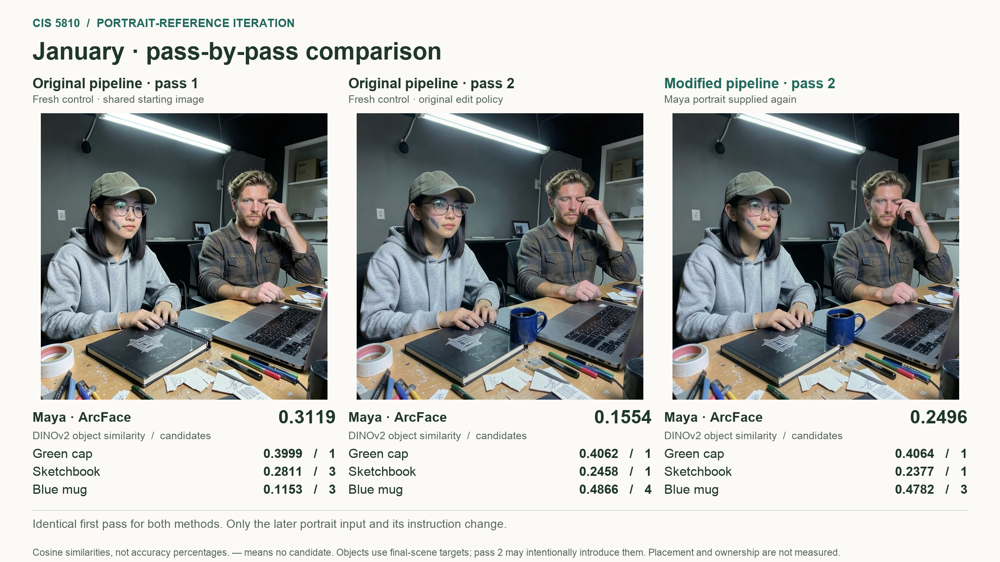

# Iteration 01 — Retaining Maya's portrait during the second pass

**Start with [index.html](index.html).** Download this folder and open that file
in a browser. It works offline and requires no API keys or software setup.

Slide figures: [January](figures/01_01_comparison.png) ·
[February](figures/02_02_comparison.png) · [May](figures/03_05_comparison.png) ·
[August](figures/04_08_comparison.png) · [October](figures/05_10_comparison.png).

For the teammate making the PowerPoint:

1. Open the five PNGs in **figures/**. These are 2400 × 1350, ready to insert into
   a 16:9 slide. January, February, August and October compare three real stages.
   May shows its single shared pass.
2. Read **[ANALYSIS.md](ANALYSIS.md)** for the method, findings, limitations and
   suggested presentation sequence.
3. Use **images/** for full-resolution original photos or **evidence/** for face
   and object crops and detection overlays.
4. Use **results/face_scores.csv** and **results/object_scores.csv** to create
   editable charts or tables. Blank scores mean unassigned/not detected, not zero.
5. **results/raw/** contains unchanged numerical results. **records/** preserves
   the frozen story, prompts, manifests, request log, targets and source hashes.

The main three-column comparison is:

**Original method, pass 1 → Original method, pass 2 → Portrait retention, pass 2.**

These are the **fresh controlled replay**. Both methods use exactly the same
first-pass image. The earlier historical pilot is preserved separately in the
viewer and package because its starting images differ. It is not the causal
comparator for the modified second pass.

Some objects are intentionally introduced in the second pass. First-pass object
scores use the final-scene target list for a consistent display; a missing object
at that stage is not automatically a generation error.

The result is mixed. “Modified second pass” names the proposed improvement;
it does not claim every image or the whole pipeline improved. October's assigned
Maya score switches to the wrong person and is prominently marked.

Identical image bytes are stored once. `records/asset_manifest.json` maps every
original source path to its packaged path and SHA-256. Raw score/manifest paths
retain their original form; use that map to resolve them in this archive.

## Rebuilding the package

The repository contains `examples/package_portrait_iteration.py` and
`examples/render_iteration_figures.py`. Packaging reads saved evidence and never
generates photographs. First-pass object inference is separate in
`examples/score_iteration_first_pass.py`; its CPU models and settings match the
saved final-image object evaluator. Model weights, environments, credentials and
reviewer submissions are deliberately absent from this package.

All photos depict a fictional character. The project and saved baseline came
from `aking526/ai-camera-roll`; Codex assisted with this iteration's implementation,
evaluation, tests and presentation assets. Include this assistance and the
pretrained model sources in the final project's AI-use/open-source attribution.
